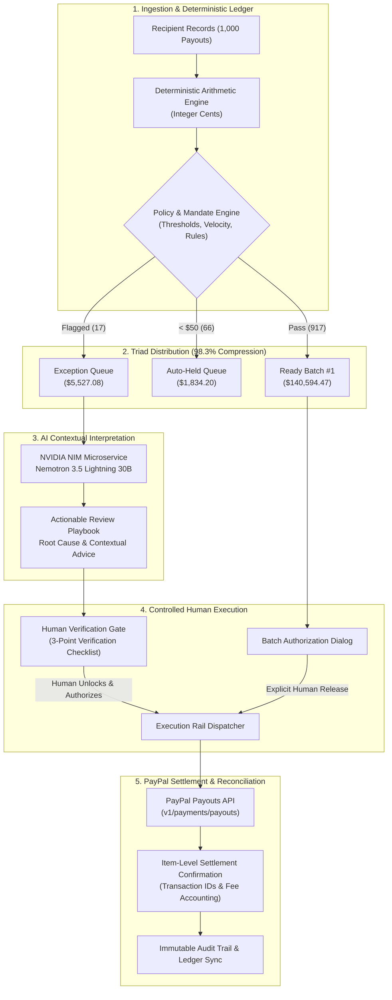

# ACTOVRA

**Where AI decisions become controlled actions.**  
*Controlled execution for AI-driven commerce.*

> **Core Thesis:** AI needs a mandate, not a blank check.

[]()
[](LICENSE)
[]()
[]()
[]()

---

## 1. The Problem

High-volume commercial platforms face an operational and governance dilemma when managing disbursements to affiliates, marketplace sellers, creators, and gig contractors:

- **Manual review does not scale:** Manually auditing hundreds or thousands of routine payouts every settlement cycle creates immense administrative drag, delays partner payouts, and causes severe reviewer fatigue where critical anomalies slip through.
- **Autonomous AI cannot be trusted with funds:** Granting an LLM or autonomous agent direct API authorization to disburse corporate capital is catastrophic. AI models hallucinate, suffer prompt injection, lack mathematical consistency, and cannot be held legally or financially accountable.

Enterprises are caught between **unscalable manual bureaucracy** and **unacceptable autonomous risk**.

---

## 2. The Solution

**ACTOVRA** provides the controlled execution layer between AI decision intelligence and real-world financial settlement.

Instead of letting AI touch money or forcing humans to review every routine row, ACTOVRA establishes a defense-in-depth pipeline:

```
Recipients / Ledger Data
  → Deterministic Integer-Cent Financial Arithmetic
  → Deterministic Financial Mandate Evaluation (100% Policy Pass)
  → AI Anomaly Analysis on Isolated Exceptions Only
  → Human Verification Gate (Unlocks Execution)
  → PayPal Sandbox Payouts Execution
  → Item-Level Reconciliation & Immutable Audit Trail
```

AI is deployed strictly where it excels—**contextual interpretation and unstructured anomaly explanation**—while deterministic code computes money and human operators retain exclusive disbursement authority.

---

## 3. Hero Use Case: Payout Intelligence for Mass Disbursements

ACTOVRA is purpose-built for commercial platforms managing high-velocity mass disbursements:
- **Affiliate Networks:** Monthly commission runs with complex clawbacks, refund deductions, and volume adjustments.
- **Creator Marketplaces:** Ad revenue and sponsorship shares subject to sudden viral traffic surges.
- **Digital Seller Platforms:** Multi-vendor marketplace settlements with balance thresholds and rolling reserves.
- **Contractor & Gig Workforces:** Velocity-limited payouts with strict account and destination change controls.

---

## 4. Exception Compression (1,000 → 17 Decisions)

In ACTOVRA's verified demo settlement run (October 2026 Affiliate Settlement), the system processes **1,000 recipient payout decisions** totaling **$147,930.75**:

| Segment | Recipients / Decisions | Volume (USD) | Governance Routing |
| :--- | :---: | :---: | :--- |
| **READY BATCH #1** | **917** | **$140,594.47** | Passed 100% of policy mandates; staged for single-click human batch authorization. |
| **HELD AUTOMATICALLY** | **66** | **$1,834.20** | Positive balances below the $50 minimum threshold; rolled over deterministically. |
| **EXCEPTIONS QUEUE** | **17** | **$5,527.08** | Isolated anomalies requiring human evaluation and AI contextual interpretation. |

### 98.3% Exception Compression
By deterministically routing 917 clean records to the Ready Batch and automatically holding 66 sub-threshold balances, ACTOVRA achieves **98.3% exception compression**, reducing the manual audit workload from 1,000 records to just **17 human decisions**.

> **Operational Time Estimate Note:**  
> Based on an illustrative baseline assumption of 30 seconds per routine manual review, auditing 1,000 payouts requires approximately **8 hours and 20 minutes**. With ACTOVRA isolating 17 exceptions, the review workload drops to approximately **8 minutes and 30 seconds**. This comparison is an illustrative operational estimate based on the stated 30-second assumption, not a measured customer benchmark.

---

## 5. Deterministic Financial Integrity: AI Explains, Code Calculates

A foundational tenet of ACTOVRA is the absolute separation of **financial arithmetic** from **natural language intelligence**:

- **Money is computed in deterministic integer cents.** All addition, subtraction, refunds, and adjustments execute via deterministic code with zero floating-point drift and zero LLM arithmetic.
- **AI never sets or alters payable balances.**

### Concrete Case: Sarah Jenkins (`rec_004`)
Sarah Jenkins is flagged in the exception queue for an unusual payout surge:
- **Gross Payout:** `$512.40` (51,240¢)
- **Refund Deductions:** `-$63.70` (-6,370¢)
- **Prior Adjustment:** `-$20.00` (-2,000¢)
- **Net Payable Balance:** **`$428.70`** (42,870¢)
- **Historical 90-Day Baseline:** `$110.00`

**AI did NOT calculate her $428.70 balance.** Deterministic ledger arithmetic calculated it.  
NVIDIA NIM / Nemotron 3.5 provides the *contextual explanation* of why her balance is unusual relative to her baseline.

---

## 6. Real AI Role: Contextual Anomaly Interpretation

ACTOVRA integrates with **NVIDIA NIM** (Inference Microservice) using:
- **Provider:** NVIDIA NIM
- **Model ID:** `nvidia/nemotron-3.5-lightning-30b-a3b`
- **Provenance:** `REAL_AI`

### What AI Does:
1. Receives structured exception context (historical baseline, current gross, refund ratios, promotional flags).
2. Synthesizes multi-source context to generate plain-language root cause explanations (e.g. confirming that Sarah Jenkins's 289% surge stemmed from verified TikTok campaign traffic with an acceptable 12.4% refund rate).
3. Produces actionable recommendations (`APPROVE`, `HOLD`, or `ESCALATE`) along with confidence scoring and risk summaries.

### What AI NEVER Does:
- AI **cannot** calculate or modify financial balances.
- AI **cannot** approve disbursements.
- AI **cannot** sign or execute transactions.
- AI **cannot** bypass policy mandates.

---

## 7. Deterministic Financial Mandates (PolicyEngine)

Before any funds can move, every transaction and batch must satisfy deterministic, hardcoded governance constraints in [`src/payouts/financialMandateEngine.ts`](src/payouts/financialMandateEngine.ts):

1. **Minimum Payout Floor:** Balances below $50.00 USD are automatically held and rolled over.
2. **Historical Velocity Limiter:** Payouts exceeding 250% of an affiliate's 90-day average trigger an automatic exception flag.
3. **Refund Ratio Ceiling:** Refund rates exceeding 15% of gross volume trigger clawback investigation.
4. **Destination Change Quarantine:** Beneficiary accounts with PayPal email or payment destination changes within 72 hours are frozen pending two-factor callback verification.
5. **Beneficiary De-duplication:** Disallows multiple payee accounts routing to the same underlying PayPal handle without agency authorization.
6. **Hard Budget Ceilings:** Absolute cap preventing batch authorizations exceeding configured operational limits.

---

## 8. Human Authority: The Final Approval Gate

AI recommends; only humans authorize.

In ACTOVRA's Exception Review Playbook:
- The disbursement action button remains **disabled and cryptographically locked**.
- Unlocking the button requires the human operator to explicitly inspect and verify each required checklist requirement (e.g., verifying promotional analytics, confirming refund reserves, and validating payment routing).
- Resetting the demo or reloading cleanly restores the locked fail-closed state.

---

## 9. PayPal Integration & Live Sandbox Proof

ACTOVRA uses the **PayPal Payouts API** as its financial settlement rail.

```
ACTOVRA Authorized Batch
  → POST /v1/payments/payouts
  → PayPal Sandbox Settlement Engine
  → Item-Level Transaction IDs & Fee Tracking
  → ACTOVRA Reconciliation Ledger
```

### Verified Real PayPal Sandbox Proof
The integration is proven through real execution on the PayPal Sandbox:
- **PayPal Batch ID:** `H6YTQ7QCBF4RU`
- **Total Settlement:** `$2.00 USD`
- **Items:** `2 payout items` (`$1.00 USD` each)
- **Status:** `SUCCESS`
- **Total Fees:** `$0.04 USD`
- **Item 1 Transaction ID:** `0M8674253S413814U`
- **Item 2 Transaction ID:** `20L273890X686941Y`

> **Truthfulness & Scope Lock:**  
> - Both payout items in this proof batch were sent to the same verified developer Sandbox recipient account. They represent **two payout items in a multi-item batch**, not multiple distinct human recipients.
> - The **$140,594.47 Ready Batch #1** was **NOT executed**; it is staged in the demo interface for visual mandate inspection and intentionally stops for human authorization. Real execution proof is strictly the verified $2 Sandbox batch.

---

## 10. Architecture



---

## 11. Technology Stack

### Product Architecture & Runtime
- **Application Framework:** Next.js 16.4.0 (App Router, Turbopack)
- **UI & State:** React 19.3.0, CSS Modules, Responsive Enterprise Viewports
- **Type Safety & Schemas:** TypeScript 5, Zod 4.6.5
- **Local Persistence & Ledger:** SQLite (`better-sqlite3` 13.0.3) with WAL journaling
- **Test Framework:** Vitest 5.0.3, JSDOM, React Testing Library

### Product AI Engine
- **Inference Infrastructure:** NVIDIA NIM (Microservice API)
- **Model:** `nvidia/nemotron-3.5-lightning-30b-a3b`
- **Role:** Contextual anomaly interpretation and natural language recommendations.

### Financial Execution Rail
- **Provider:** PayPal Developer Platform
- **APIs:** PayPal Sandbox Payouts API (`/v1/payments/payouts`), OAuth 2.0 Token Authentication

### Demo & Video Production Tools *(Separated from Product Runtime)*
- **Demo Recording Automation:** Playwright (headless browser capture)
- **Video Assembly & Color Grading:** FFmpeg 6.1 (1080p / 25 fps H.264)
- **Demo Narration:** Synthesized out-of-band via Google Gemini 2.5 Pro TTS (Algieba voice). *Gemini TTS is strictly a multimedia production tool and is not part of the ACTOVRA product runtime.*
- **Soundtrack:** "Future Finance Today" by higheruniversalman (Pixabay).

---

## 12. Local Setup & Reproduction

### Prerequisites
- Node.js 22+ or Node.js 24 (recommended: `v24.22.1`)
- npm 10+
- Linux / macOS / WSL2

### Installation

1. **Clone the repository:**
   ```bash
   git clone https://github.com/your-org/actovra.git
   cd actovra
   ```

2. **Install dependencies:**
   ```bash
   npm install
   ```

3. **Configure environment:**
   ```bash
   cp .env.example .env.local
   ```

---

## 13. Configuration

Edit `.env.local` with your developer sandbox credentials. **Never commit real credentials.**

### PayPal Sandbox Credentials
Obtain sandbox credentials from the [PayPal Developer Dashboard](https://developer.paypal.com/dashboard/):
```env
PAYPAL_CLIENT_ID=your_sandbox_client_id_here
PAYPAL_CLIENT_SECRET=your_sandbox_client_secret_here
PAYPAL_API_BASE=https://api-m.sandbox.paypal.com
```

### NVIDIA NIM API Credentials
Obtain an API key from the [NVIDIA Build Console](https://build.nvidia.com/):
```env
NVIDIA_API_KEY=your_nvidia_api_key_here
NVIDIA_API_BASE=https://integrate.api.nvidia.com/v1
NVIDIA_MODEL=nvidia/nemotron-3.5-lightning-30b-a3b
```

### Local Offline Exploration
ACTOVRA contains a built-in mock fallback for offline evaluation. If no credentials are provided in `.env.local`, the server boots safely using mock fallback defaults, allowing full exploration of the interface and deterministic ledger.

---

## 14. Running the Application

### Start Development Server
```bash
npm run dev
```
Open [http://localhost:3000](http://localhost:3000) in your browser.

### Production Build & Local Server
```bash
npm run build
npm start
```

---

## 15. Testing & Verification

ACTOVRA is backed by a test matrix covering unit arithmetic, policy rules, component rendering, and UI states:

```bash
# Run complete test suite (539 passing tests)
npm test

# Run TypeScript typecheck (0 errors)
npm run typecheck

# Run ESLint (0 errors, 0 warnings)
npm run lint
```

---

## 16. Live Demo

The production application is deployed and live at:
**[https://commercepilot.toolspacehub.com](https://commercepilot.toolspacehub.com)**

---

## 17. AI & Security Disclosures

- **NVIDIA NIM Disclosure:** ACTOVRA utilizes NVIDIA NIM with `nvidia/nemotron-3.5-lightning-30b-a3b` strictly for post-calculation contextual anomaly evaluation. AI is prohibited from computing financial amounts or executing transactions.
- **Fail-Closed Gate:** If NVIDIA NIM is unreachable or returns malformed output, the system fails closed into an escalating review queue; it never executes.
- **PayPal Sandbox Notice:** All financial transactions displayed or executed in this demonstration utilize the PayPal Sandbox environment. No real fiat funds are transferred.

---

## 18. License & Commercial Inquiries

ACTOVRA is open-source software licensed under the **GNU Affero General Public License Version 3 or later** ([AGPL-3.0-or-later](LICENSE)).

Users are free to run, study, modify, and redistribute the project under the terms of the GNU AGPLv3. Under the AGPL, if you modify ACTOVRA and run it over a computer network to provide services to users, you must make the corresponding source code available under the same license terms.

### Commercial & Enterprise Inquiries
Organizations seeking to incorporate ACTOVRA-owned code into proprietary or closed-source products and services without complying with the applicable AGPL copyleft obligations may contact the copyright holder regarding a separate commercial license. 

- **Commercial Licensing Document:** See [`COMMERCIAL_LICENSE.md`](COMMERCIAL_LICENSE.md) for licensing structure details.
- **Inquiries:** Contact `contact@toolspacehub.com` with licensing details. Commercial terms are negotiated separately by the copyright holder and are not automatically granted.
- **Third-Party Upstream Software:** A commercial license from the copyright holder covers only ACTOVRA-owned source code. Third-party dependencies and assets remain governed by their respective upstream open-source licenses (see [`THIRD_PARTY_NOTICES.md`](THIRD_PARTY_NOTICES.md)).

### Hackathon Evaluation
This repository is provided publicly for PayPal AI Hackathon judging under its stated open-source license and the applicable hackathon rules.
